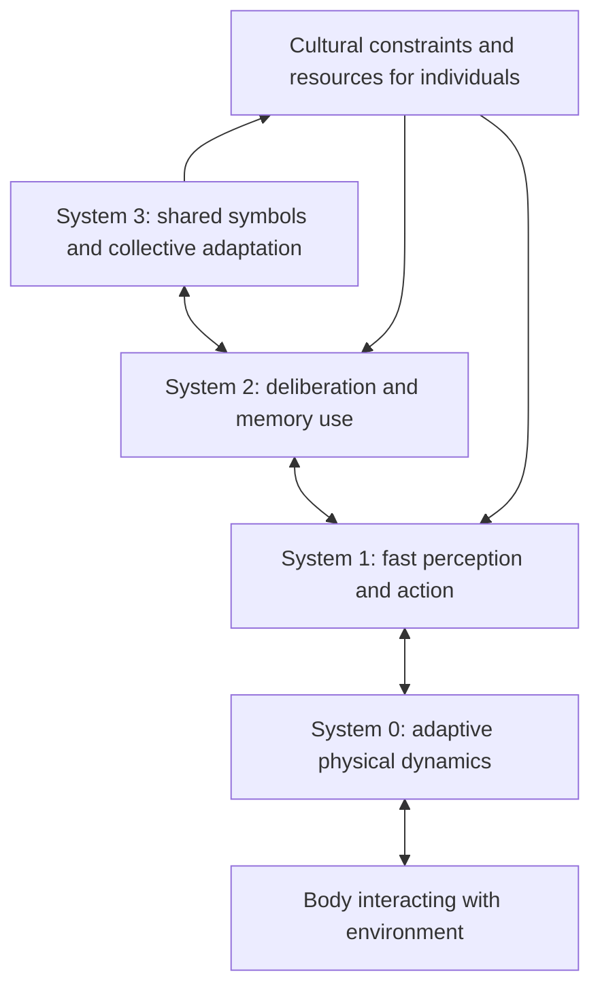

# System 0/1/2/3 Reading Guide

**An unofficial, source-linked reading companion to _System 0/1/2/3: Quad-process theory for multi-timescale embodied collective cognitive systems_.**

For researchers, engineers, curious readers, and AI agents. This guide explains the paper's conceptual architecture, embodied and neural foundations, collective predictive coding (CPC), Bergsonian interpretation, and open research questions. **The paper proposes a theory and research agenda. This repository does not empirically validate that theory, implement its architecture, or reproduce experiments.**

> **Research credit belongs to all six authors:** Tadahiro Taniguchi, Yasushi Hirai, Masahiro Suzuki, Shingo Murata, Takato Horii, and Kazutoshi Tanaka.
>
> **Version studied: arXiv:2503.06138v3, 16 July 2025, 41 PDF pages.** [Versioned record](https://arxiv.org/abs/2503.06138v3) · [Versioned PDF](https://arxiv.org/pdf/2503.06138v3) · [Versioned HTML](https://arxiv.org/html/2503.06138v3).
>
> Maintained by [0xHayd3n](https://github.com/0xHayd3n), with AI assistance. Unaffiliated with and not endorsed by the paper's authors. This is a **v3-only companion**; no earlier-version guide is included.

## The idea in one minute

Fast intuition and slow deliberation describe only part of the adaptive activity that interests the authors. A compliant robot hand can absorb contact mechanically before a controller reasons about it. A community can change its vocabulary and institutions across generations. The proposed quad-process framework places these bodily and collective processes alongside individual cognition. [§1, PDF pp.3–5](https://arxiv.org/pdf/2503.06138v3#page=3)

| System | What the authors bring into focus | Timescale language | A reading caution |
| --- | --- | --- | --- |
| **0** | Adaptive body–environment dynamics, including morphology and passive mechanics | Super-fast | Physical computation does not require conscious or explicit neural calculation. |
| **1** | Rapid perception, implicit representations, and intuitive action | Fast | A useful conceptual category, not a measured universal neural module. |
| **2** | Deliberation, explicit internal representations, and attentive recognition | Slow | The association with language models does not identify every LLM operation with deliberation. |
| **3** | Shared symbolic systems formed and revised through social interaction | Super-slow | A group exchanging fixed language is only part of the story; symbol-system adaptation matters. |

Original summary based on [§§3.1–3.3, Figure 3 and Table 1, PDF pp.15–21](https://arxiv.org/pdf/2503.06138v3#page=15). These are **relative descriptions**, not numerical cutoffs or four isolated boxes. The authors distinguish the speed of current processing, the history that formed an adaptive landscape, and the width of the present window in [§4.1, PDF pp.22–23](https://arxiv.org/pdf/2503.06138v3#page=22).



This is an original orientation diagram inspired by §3, not an implementation or a reproduction of a paper figure. System 3 spans interacting agents; the vertical layout should not suggest that it sits inside one brain.

## Start reading

| Your goal | Start here |
| --- | --- |
| Understand the motivation, background, and vocabulary | [Concepts and context](docs/01-concepts-and-context.md) |
| Understand physical embodiment and individual cognition | [Embodiment and individual cognition](docs/02-embodiment-and-individual-cognition.md) |
| Follow System 3, variables, and the CPC objective | [Collective predictive coding](docs/03-collective-predictive-coding.md) |
| Separate the three time axes and understand memory | [Time, memory, and canalization](docs/04-time-memory-and-canalization.md) |
| Assess claims, implications, limitations, and future tests | [Implications, limitations, and questions](docs/05-implications-limitations-and-questions.md) |
| Locate every section, figure, table, equation, and end-matter span | [Complete paper map](docs/06-paper-map.md) |
| Read with an agent | [AGENTS.md](AGENTS.md), [LLMS.txt](LLMS.txt), [paper metadata](metadata/paper.json), [claim index](metadata/claims.json) |

**Short route:** README → concepts → implications and limitations.

**Technical route:** embodiment → CPC with the rendered PDF p.18 open → time and memory → proposed tests.

**Source-first route:** keep the versioned PDF next to the paper map. All citations here use **one-based PDF pages**. From the introduction onward, PDF page = printed page +2; the front matter uses different numbering.

## What the paper contributes

| Contribution or claim | Status and qualification | Primary location |
| --- | --- | --- |
| Extend dual-process theory to include embodied System 0 and collective System 3 | A proposed synthesis. CPC and embodied examples draw on earlier work; this is not evidence that four systems exhaust all cognition. | [§1, pp.4–5](https://arxiv.org/pdf/2503.06138v3#page=4), [§3.1, pp.15–17](https://arxiv.org/pdf/2503.06138v3#page=15) |
| Treat symbol emergence as decentralized inference over distributed experience | CPC hypothesis and formalization, with supporting models cited from prior research. No new society-scale validation is reported. | [§3.2, pp.17–19](https://arxiv.org/pdf/2503.06138v3#page=17) |
| Relate embodied, learned, and social adaptation to canalized landscapes and an elastic present | The authors' extended interpretation of Bergson, not a demonstrated identity between philosophical concepts and neural mechanisms. | [§4, pp.21–27](https://arxiv.org/pdf/2503.06138v3#page=21) |
| Propose tests of morphology-shaped language and adaptation through semiotic plasticity | Two future comparisons: groups with different robot morphologies; changeable versus frozen language after an environmental shift. These are not reported results. | [§5.1, p.28](https://arxiv.org/pdf/2503.06138v3#page=28) |
| Discuss consciousness and collective subjectivity | Conscious processing is distinguished from subjective experience; collective consciousness remains speculative. | [§3.3, p.21](https://arxiv.org/pdf/2503.06138v3#page=21), [§5.2, p.29](https://arxiv.org/pdf/2503.06138v3#page=29) |

## Three distinctions to keep throughout

1. **Theory, reviewed evidence, and future predictions:** passive walkers, neural models, naming games, and language experiments are discussed as background or cited prior work. They are not new tests of the entire quad-process framework.
2. **Communication and symbol emergence:** short-term messages can use an existing code; long-term collective adaptation can reshape the code and its relation to experience. System 3 includes both dynamics. [§3.3, p.20](https://arxiv.org/pdf/2503.06138v3#page=20)
3. **Processing, formation, and temporal integration:** a mechanically immediate response may depend on morphology formed over evolutionary time. A longer conversational record does not by itself prove a longer biological perceptual present. [§§4.1–4.4, pp.22–27](https://arxiv.org/pdf/2503.06138v3#page=22)

The [CPC module](docs/03-collective-predictive-coding.md#notation-and-derivation-cautions) also flags a visible Equation 4 typesetting issue and assumptions needed to interpret the free-energy decomposition. The guide does not silently repair the paper or present the displayed equations as executable specifications.

## Use this repository with an agent

Read [AGENTS.md](AGENTS.md) first. For example:

```text
Using this guide and arXiv:2503.06138v3 only, explain how System 3 differs
from a team of agents using a fixed vocabulary. Cite the section and PDF page.
Separate the authors' hypothesis, cited prior support, and your interpretation.
Identify what a new experiment would need to measure.
```

The claim index records source locations, claim types, and essential caveats. It is a navigation aid, not an independent evidence base.

## Repository contents

```text
README.md                 Overview, credits, routes, conceptual findings
AGENTS.md                 Source-grounding and editing rules
LLMS.txt                  Compact agent navigation
docs/01-... through 06-... Detailed reading modules and complete source map
metadata/paper.json       Version, authors, license, and provenance
metadata/claims.json      Typed, source-linked claims with scope and caveats
metadata/sources.json     Source register and verification boundaries
references/paper.bib      Paper citation with all six authors
CITATION.cff              Companion metadata and preferred paper citation
ATTRIBUTION.md            Research credit and rights boundaries
LICENSE                   License for original guide material
CONTRIBUTING.md           Correction and evidence standards
VERIFICATION.md           Checks performed and their limits
scripts/validate_repository.py
.github/workflows/validate.yml
```

## Cite and credit

Cite **Taniguchi, Hirai, Suzuki, Murata, Horii, and Tanaka (2025)** for the research. Use the [v3 record](https://arxiv.org/abs/2503.06138v3), [BibTeX](references/paper.bib), or preferred citation in [CITATION.cff](CITATION.cff). The arXiv DOI [10.48550/arXiv.2503.06138](https://doi.org/10.48550/arXiv.2503.06138) identifies the work; the versioned links specify this guide's source.

Original guide prose, metadata, and diagrams are licensed under **CC BY 4.0**. The paper separately uses the **arXiv non-exclusive distribution license**, which is not a Creative Commons reuse grant. No PDF, full paper text, original figures, or author implementation is redistributed. See [ATTRIBUTION.md](ATTRIBUTION.md) and [LICENSE](LICENSE).

## Quality and maintenance

```bash
python scripts/validate_repository.py
```

The checker covers documentation, local links and anchors, version pins, page ranges, citation consistency, and structured metadata. It does not validate the scientific theory or external reachability.

Prepared on **20 October 2026** from the entire supplied Library attachment text, with all five figure pages, Table 1, and the equation page visually checked in the exact official v3 PDF. The public PDF was used for those visual checks; its binary equality to the attachment was not established. Details and checks are in [VERIFICATION.md](VERIFICATION.md) and [metadata/paper.json](metadata/paper.json). Corrections with precise primary-source evidence are welcome.
